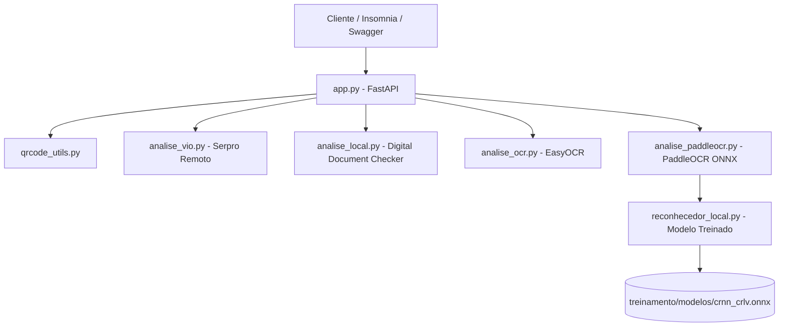

# Documentação dos Analisadores de Documentos (CRLV, CNH, CIN)

Este projeto unifica 4 analisadores distintos de documentos em uma única API FastAPI, cobrindo validação remota oficial, validação criptográfica offline, OCR geométrico e OCR treinado localmente.

---

## 1. Onde os Analisadores se Encontram (Ponto Central)

O ponto de convergência de todos os analisadores é o arquivo [src/teste_leitor_crlv/app.py](file:///C:/Users/user/Documents/teste-leitor-crlv/src/teste_leitor_crlv/app.py).

### Arquitetura de Unificação


- **Entrypoint**: [app.py](file:///C:/Users/user/Documents/teste-leitor-crlv/src/teste_leitor_crlv/app.py) inicializa a aplicação FastAPI e registra os 4 roteadores (`APIRouter`).
- **Utilitário Compartilhado**: [qrcode_utils.py](file:///C:/Users/user/Documents/teste-leitor-crlv/src/teste_leitor_crlv/qrcode_utils.py) provê `extrair_bytes_qrcode` (`zxing-cpp`) e `gerar_qrcode_base64` (`segno`).
- **Endpoint Raiz de Descoberta**: `GET http://localhost:8000/` retorna o status e catálogo de todos os modos disponíveis.
- **Documentação Interativa**: Swagger UI em `http://localhost:8000/docs` e OpenAPI JSON em `http://localhost:8000/openapi.json`.
- **Coleção de Testes Pronta**: [insomnia_collection.json](file:///C:/Users/user/Documents/teste-leitor-crlv/insomnia_collection.json) contém requisições configuradas para todos os analisadores.

---

## 2. Analisadores por Tipo e Responsabilidade

### Analisador 1: VIO Remoto (API Serpro)
- **Arquivo**: [src/teste_leitor_crlv/analise_vio.py](file:///C:/Users/user/Documents/teste-leitor-crlv/src/teste_leitor_crlv/analise_vio.py)
- **Biblioteca Base**: `vio-api`
- **Tipo de Validação**: Remota (online) via consulta oficial na nuvem Serpro/SENATRAN com chave de acesso.
- **Funcionamento**:
  1. Extrai bytes binários brutos do QR Code na imagem via `zxingcpp`.
  2. Reconstrói a imagem do QR Code em Base64 via `segno`.
  3. Envia para a API Serpro via cliente `VioClient()`.
- **Endpoints**:
  - `POST /api/consultar-imagem` (`multipart/form-data`: campo `file`, flags `wait` e `incluir_qrcode_base64`)
  - `POST /api/consultar` (JSON: `imagem_base64`, `caminho_imagem` ou `texto`)

---

### Analisador 2: Validador Local Offline (Digital Document Checker)
- **Arquivo**: [src/teste_leitor_crlv/analise_local.py](file:///C:/Users/user/Documents/teste-leitor-crlv/src/teste_leitor_crlv/analise_local.py)
- **Biblioteca Base**: `digital-document-checker`
- **Tipo de Validação**: Local, offline (custo zero de API, sem envio de dados para rede).
- **Funcionamento**:
  1. Extrai bytes brutos do QR Code da imagem.
  2. Decodifica assinaturas digitais (ECDSA / RSA / JWS) usando as chaves públicas oficiais embutidas dos órgãos emissores (SENATRAN, SERPRO, MJSP).
  3. Decodifica dados biométricos, dados do condutor e do veículo.
- **Endpoints**:
  - `POST /api/validar-localmente-imagem` (`multipart/form-data`: campo `file`, flag `include_raw`)
  - `POST /api/validar-localmente` (JSON: `imagem_base64`, `caminho_imagem` ou `qrcode_base64`)

---

### Analisador 3: OCR Geométrico (EasyOCR + PyMuPDF)
- **Arquivo**: [src/teste_leitor_crlv/analise_ocr.py](file:///C:/Users/user/Documents/teste-leitor-crlv/src/teste_leitor_crlv/analise_ocr.py)
- **Bibliotecas Base**: `easyocr`, `pymupdf`, `Pillow`, `opencv-python-headless`
- **Tipo de Validação**: Leitura óptica de documento físico/digital (CRLV-e em PDF ou foto/scan).
- **Recursos Principais**:
  - **Correção EXIF**: `ImageOps.exif_transpose` para fotos de celular com metadados de orientação.
  - **Auto-Orientação**: `corrigir_orientacao` via rotação OpenCV (90° e 270°) se faltar PLACA/RENAVAM.
  - **Crop Dinâmico**: `delimitar_documento_pelos_textos` ignora mesa/fundo e calcula dimensões relativas do documento.
  - **6 Âncoras Relativas**: República Federativa, Certificado de Registro, RENAVAM, Placa, Exercício, Número do CRV.
  - **Autocorreção de Caracteres**: `corrigir_placa` converte confusões de OCR (O↔0, I↔1, Z↔2, S↔5, B↔8) segundo a gramática de placas Mercosul/antigas.
- **Endpoints**:
  - `POST /api/ocr-crlv-imagem` (`multipart/form-data`: campo `file`, `margem_erro`)
  - `POST /api/ocr-crlv` (JSON: `caminho_arquivo`, `imagem_base64`, `margem_erro`)

---

### Analisador 4: PaddleOCR + Aprendizado Local ONNX
- **Arquivos**:
  - Analisador: [src/teste_leitor_crlv/analise_paddleocr.py](file:///C:/Users/user/Documents/teste-leitor-crlv/src/teste_leitor_crlv/analise_paddleocr.py)
  - Reconhecedor Local: [src/teste_leitor_crlv/reconhecedor_local.py](file:///C:/Users/user/Documents/teste-leitor-crlv/src/teste_leitor_crlv/reconhecedor_local.py)
  - Pipeline de Treino: [treinamento/](file:///C:/Users/user/Documents/teste-leitor-crlv/treinamento)
- **Bibliotecas Base**: `paddleocr`, `paddlepaddle`, `onnxruntime`, `torch`
- **Tipo de Validação**: Leitura OCR com PP-OCRv6 em runtime ONNX e priorização automática de pesos treinados localmente.
- **Recursos Principais**:
  - **Priorização Automática**: detecta se [treinamento/modelos/crnn_crlv.onnx](file:///C:/Users/user/Documents/teste-leitor-crlv/treinamento/modelos/crnn_crlv.onnx) existe e ativa o motor `local_treinado`. Caso ausente, utiliza o modelo base automaticamente.
  - **Active Learning**: salva fotos com falha de validação em `dados_treinamento/falhas/` gerando um `id_amostra_salva` para composição contínua do dataset.
  - **Feedback do Usuário**: endpoint dedicado para registrar placa e RENAVAM corretos.
  - **Treinamento e Fine-Tuning**: scripts [treinamento/preparar_dataset.py](file:///C:/Users/user/Documents/teste-leitor-crlv/treinamento/preparar_dataset.py) e [treinamento/treinar_modelo.py](file:///C:/Users/user/Documents/teste-leitor-crlv/treinamento/treinar_modelo.py) permitem treinar a rede CRNN com novas fotos a qualquer momento.
- **Endpoints**:
  - `POST /api/paddleocr-crlv-imagem` (`multipart/form-data`: `file`, `margem_erro`, `salvar_amostra`, `usar_modelo_local`)
  - `POST /api/paddleocr-crlv` (JSON: `caminho_arquivo`, `imagem_base64`, `margem_erro`, `usar_modelo_local`)
  - `POST /api/paddleocr-feedback` (JSON: `id_amostra`, `placa_correta`, `renavam_correto`, `observacoes`)

---

## 3. Matriz Comparativa dos Analisadores

| Recurso | 1. VIO Remoto | 2. Local Checker | 3. EasyOCR | 4. PaddleOCR + Local |
| :--- | :--- | :--- | :--- | :--- |
| **Ambiente de Execução** | Nuvem Serpro | 100% Local | 100% Local | 100% Local |
| **Custo de Chamada** | Sim (Créditos Serpro) | Gratuito | Gratuito | Gratuito |
| **Dependência de Conexão** | Sim | Não | Não | Não |
| **Entrada Principal** | QR Code VIO | QR Code VIO/Gov | Texto/Foto CRLV | Texto/Foto CRLV |
| **Suporte a PDF e Fotos** | Apenas QR Code | Apenas QR Code | PDF e Fotos | PDF e Fotos |
| **Tolerância a Ângulo** | Média | Média | Alta (cv2 rotate) | Muito Alta (PP-LCNet) |
| **Treinabilidade Local** | Impossível | Chaves Criptográficas | Complexa | Nativa (CRNN/ONNX) |

---

## 4. Como Executar

```bash
# Executar a API via script registrado
uv run teste-leitor-crlv

# Ou diretamente via Uvicorn
uv run uvicorn teste_leitor_crlv.app:app --reload --port 8000
```
